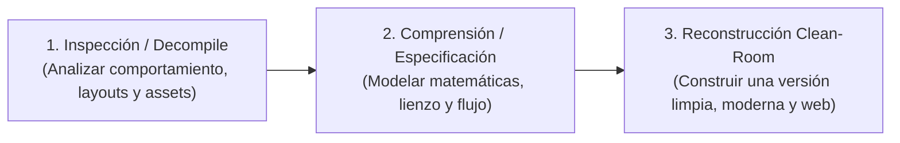
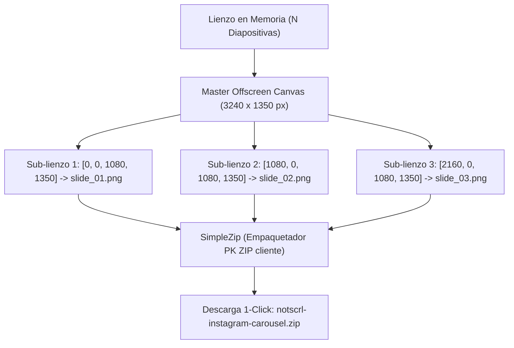

# REA Architecture & Reverse-Engineering Dossier: SCRL to NotSCRL Web

> **Dossier de Ingeniería Inversa y Reconstrucción Clean-Room**  
> Inspirado en el flujo de trabajo de [REA (Reverse Engineer Anything)](https://github.com/morluto/rea)  
> Objetivo: Recrear la funcionalidad de [SCRL](https://scrl.com/) en una aplicación Web nativa y autónoma.

---

## 1. ¿Qué es `morluto/rea` y cómo se aplica aquí?

[`morluto/rea`](https://github.com/morluto/rea) (*Reverse Engineer Anything*) es un kit de herramientas y servidor **Model Context Protocol (MCP)** creado para permitir que agentes de IA (como nosotros) inspeccionen, descompilen y analicen aplicaciones (binarios nativos, apps Electron/JS, ensamblados .NET o arquitecturas web) **sin necesidad de disponer del código fuente original**.

El paradigma central de REA para desarrolladores e IA se divide en 3 etapas:


Al analizar **SCRL (`scrl.com`)**:
* **Hallazgo clave:** SCRL es una aplicación exclusivamente para móviles (iOS App Store y Google Play). Su sitio web `scrl.com` es únicamente una página de aterrizaje (landing page de marketing). No existe un editor web oficial de SCRL.
* **Oportunidad de ingeniería inversa:** Diseñar la arquitectura matemática y la experiencia de usuario (UX) de SCRL para el navegador web: un lienzo panorámico continuo, corte automático de costuras en resolución 1080p, simulación en tiempo real del swipe de Instagram y descarga en ZIP con 1 clic.

---

## 2. Modelo Matemático del Lienzo Panorámico

### 2.1 Coordenadas del Lienzo vs. Diapositivas de Instagram

Instagram impone restricciones estrictas en las proporciones de imagen para publicaciones de carrusel:
* **Retrato (Portrait 4:5):** $1080 \times 1350\text{ px}$ (La relación de aspecto de mayor área visual en feeds móviles).
* **Cuadrado (Square 1:1):** $1080 \times 1080\text{ px}$.
* **Vertical Completo (Story/Reel 9:16):** $1080 \times 1920\text{ px}$.

Para un carrusel de $N$ diapositivas con ancho de diapositiva $W_s$ y altura $H_s$:

$$\text{Ancho Total del Lienzo } W_t = N \times W_s$$
$$\text{Altura Total del Lienzo } H_t = H_s$$

*Ejemplo (3 diapositivas en 4:5):*
$$W_t = 3 \times 1080 = 3240\text{ px},\quad H_t = 1350\text{ px}$$

### 2.2 Costuras y Cruce Continuo de Elementos (*Seam Crossing*)

La costura (*seam*) $k$ se ubica en la coordenada horizontal:
$$X_{\text{seam}, k} = k \cdot W_s \quad \text{para } k \in \{1, 2, \dots, N-1\}$$

Cualquier elemento gráfico (foto, polaroid, texto o sticker) cuyo intervalo horizontal $[x, x + w]$ intersecte la recta $X_{\text{seam}, k}$ quedará visualmente dividido:
* La porción $[x, X_{\text{seam}, k}]$ se renderiza en la Diapositiva $k$.
* La porción $[X_{\text{seam}, k}, x + w]$ se renderiza en la Diapositiva $k+1$.

Al visualizarse en Instagram mediante el gesto táctil de desplazamiento (*swipe*), el usuario experimenta una panorámica continua sin saltos ni cortes visibles.

### 2.3 Transformaciones 2D y Bounding Boxes

Cada elemento $i$ posee:
* Posición: $(x_i, y_i)$
* Dimensiones: $(w_i, h_i)$
* Ángulo de rotación: $\theta_i$ (grados)
* Centro de rotación: $(c_{x,i}, c_{y,i}) = \left(x_i + \frac{w_i}{2}, y_i + \frac{h_i}{2}\right)$

Para determinar si un punto del cursor $(P_x, P_y)$ interseca un elemento rotado:
$$\begin{bmatrix} P'_{x} \\ P'_{y} \end{bmatrix} = \begin{bmatrix} \cos(-\theta_i) & -\sin(-\theta_i) \\ \sin(-\theta_i) & \cos(-\theta_i) \end{bmatrix} \begin{bmatrix} P_x - c_{x,i} \\ P_y - c_{y,i} \end{bmatrix} + \begin{bmatrix} \frac{w_i}{2} \\ \frac{h_i}{2} \end{bmatrix}$$

El punto intersecta el elemento si y solo si:
$$0 \le P'_x \le w_i \quad \land \quad 0 \le P'_y \le h_i$$

---

## 3. Pipeline de Renderizado y Slicing (Corte)



El algoritmo de corte utiliza `CanvasRenderingContext2D.drawImage` con los 9 parámetros estándar para sub-pixel clipping:
```javascript
ctx.drawImage(
  masterCanvas,
  k * slideWidth, 0, slideWidth, slideHeight, // Coordenadas origen en el master
  0, 0, slideWidth, slideHeight               // Coordenadas destino en la diapositiva
);
```

---

## 4. Conclusión de la Recreación Clean-Room

Siguiendo la metodología de `morluto/rea`, hemos construido **NotSCRL**:
1. **100% Web y Nativo**: Corre en cualquier navegador moderno sin dependencias externas pesadas.
2. **Sin pérdida de calidad**: Renderiza directamente a la resolución nativa de Instagram (1080p).
3. **Privacidad absoluta**: Las fotos se procesan exclusivamente en la memoria RAM del navegador del usuario (cero subidas a servidores en la nube).
4. **Empaquetado ZIP autónomo**: Generador ZIP puro en JavaScript (`js/zip.js`) compatible con el estándar PKZIP sin librerías externas.
